# 单机终端图形界面教程（sshmgr tui）

这份教程面向会用终端、但第一次接触 sshmgr 的读者。你将用终端图形界面（`sshmgr tui` 命令打开的全键盘管理界面）完成单机部署：初始化本机 vault、录入一台服务器、创建服务器授权分组、给 AI agent 发访问身份，最后让 Claude Code 在目标服务器上执行一条命令。全程约 20 分钟。

单机部署指一台电脑自己保管加密 vault，AI agent 也在这台电脑上使用它。截图使用一组可丢弃的演示数据：服务器叫 `demo-gpu`，地址是 `127.0.0.1:2222`，SSH 用户是 `deploy`；profile（服务器授权分组）叫 `team-a`；project（agent 的访问身份）叫 `my-agent`。你跟做时把这些值换成自己的服务器信息即可。

截图由 [vhs 脚本](./images/single-machine/tapes/README.md) 自动生成，界面文字与当前源码一致。

## 准备值

| 项目 | 截图中的演示值 | 你要填什么 |
|---|---|---|
| 服务器名称 | `demo-gpu` | 一个你能认出的唯一名称 |
| 服务器地址 | `127.0.0.1` | 目标服务器地址 |
| SSH 端口 | `2222` | 目标服务器端口；常见默认值是 `22` |
| SSH 用户 | `deploy` | 能登录目标服务器的用户 |
| SSH 密码 | `deploy-password` | 该用户的密码；也可以改用私钥 |
| profile（服务器授权分组） | `team-a` | 一组允许 agent 访问的服务器 |
| project（agent 的访问身份） | `my-agent` | 发给 Claude Code 的身份名称 |

## 第 1 步：拿到二进制

**要做什么**：在仓库根目录编译出一个 `sshmgr` 可执行文件，并确认它能运行。下面的命令会在当前目录生成 `sshmgr`。

```bash
go build -o ./sshmgr ./cmd/sshmgr && ./sshmgr version
```

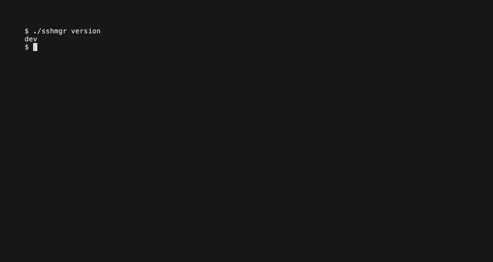

**截图里要注意什么**：`./sshmgr version` 打印版本号后就回到提示符，说明可执行文件可用。截图中的 `dev` 是本地源码构建的版本标识。

Windows 注意：

- 可执行文件名是 `sshmgr.exe`；后续命令写绝对路径，例如 `C:\Tools\sshmgr.exe`。
- 默认 master key（用于解锁 vault 的本机密钥）路径是 `C:\ProgramData\ssh-manager\master.key.plain`。
- 在 mintty 终端里启动终端图形界面要写 `winpty sshmgr.exe tui`；Windows Terminal 和 cmd 不需要 `winpty`。

对应命令行：`go build -o ./sshmgr ./cmd/sshmgr && ./sshmgr version`

## 第 2 步：选择单机角色并解锁保险柜

**要做什么**：运行 `sshmgr tui`。空机器第一次运行会进入首跑向导。第一问选择「是——凭据只存这台机」，第二问选择「只有本机用 → 单机」。

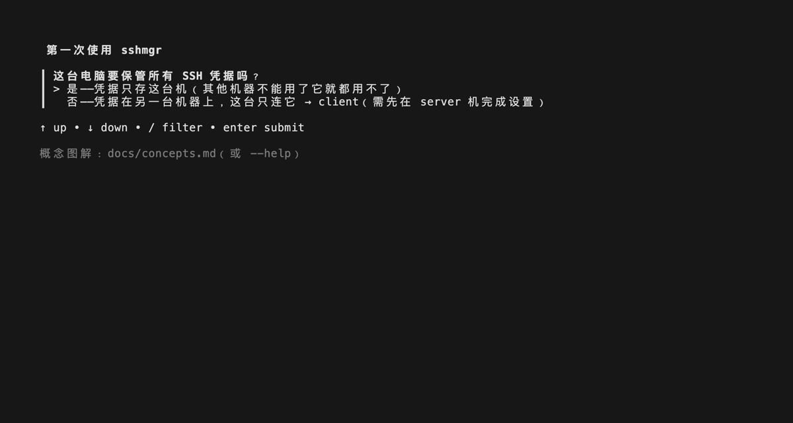

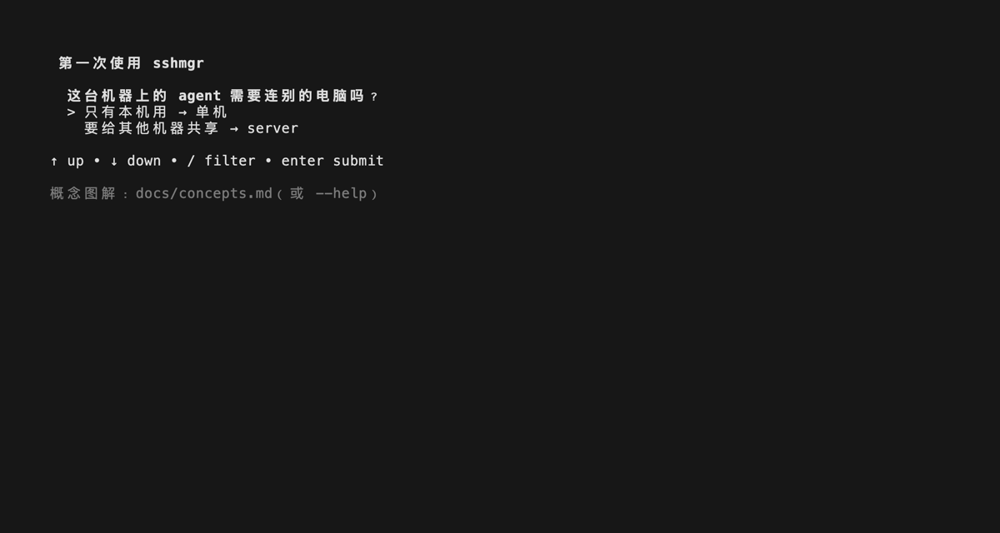

**截图里要注意什么**：

- 选择控件用上下方向键移动，回车确认。
- 第二问选择「只有本机用 → 单机」后，向导会立即生成 master key（用于解锁 vault 的本机密钥）并初始化加密数据库。这个动作很快，没有单独的中间截图；进入服务器录入问题时，状态行显示 vault 已就绪。
- 如果这台机器上已经有 vault 但处于锁定状态，向导不会覆盖它，而会提示先运行解锁命令。解锁后重新运行 `sshmgr tui` 会从断点继续。
- 表单里回车进入下一项，`Shift+Tab` 回到上一项；`q` 暂停退出，已提交的数据不会丢失。

对应命令行：`sshmgr unlock`

## 第 3 步：录入一台服务器

**要做什么**：在「现在录入第一台服务器？」选择确认，然后填写连接信息。名称、地址、SSH 用户和端口是必填项；截图只录入密码，其他可选项目直接回车跳过。

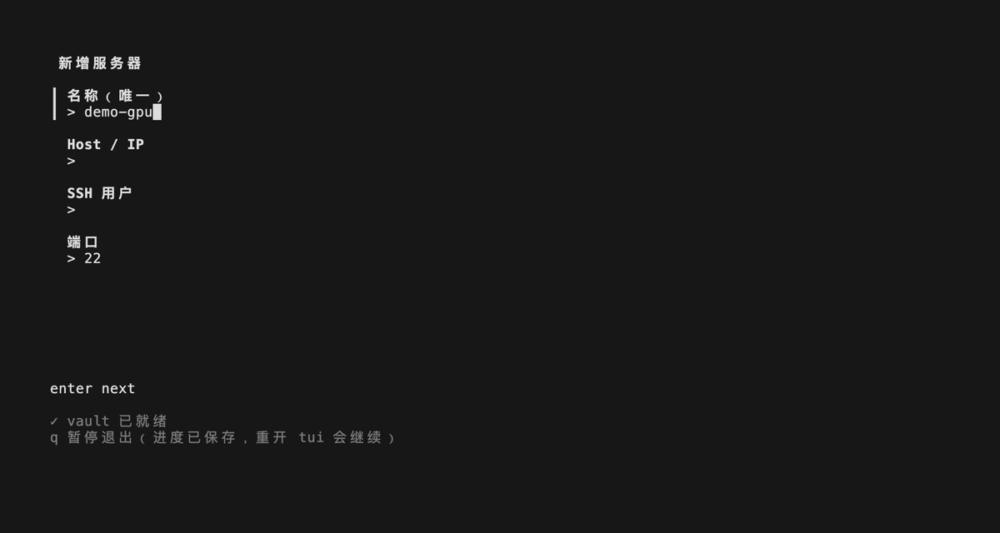

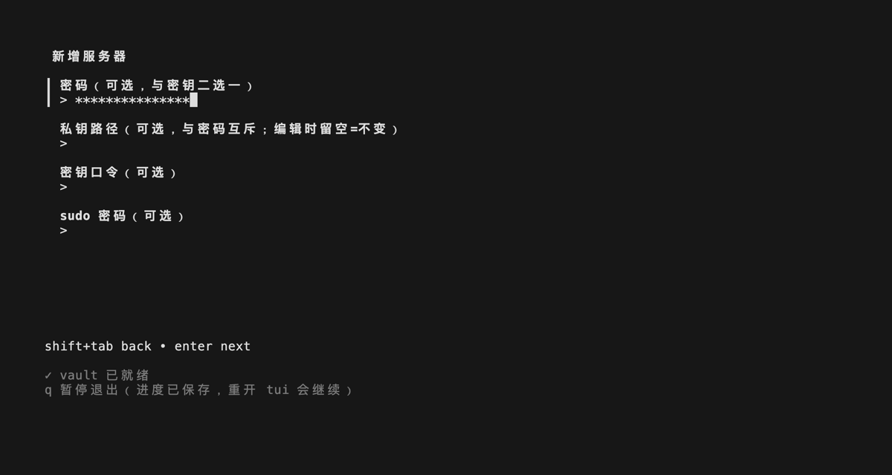

**截图里要注意什么**：

- 第一张图已填入名称 `demo-gpu`。端口默认是 `22`；要填 `2222` 时先用 `Ctrl+U` 清空输入行，再输入 `2222`。
- 第二张图在密码输入框输入 `deploy-password`。输入内容只显示掩码，不会回显明文。
- 密码和私钥路径二选一；两个都填会被拒绝。sudo 密码、结构化备注都可以留空。结构化备注会展示给 agent，不要放密码、私钥或其他机密。
- 最后一项提交后，向导会询问是否继续添加下一台服务器。本教程只录一台，选择「No」。随后向导进入 profile（服务器授权分组）创建步骤。

对应命令行：`sshmgr servers add --name demo-gpu --host 127.0.0.1 --port 2222 --user deploy --password '你的SSH密码'`

## 第 4 步：创建服务器授权分组并授权

**要做什么**：把默认 profile 名称改成 `team-a`，然后在多选列表里勾选 `demo-gpu`。

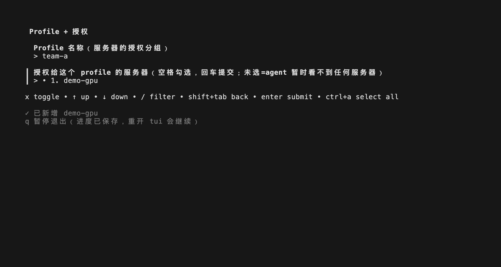

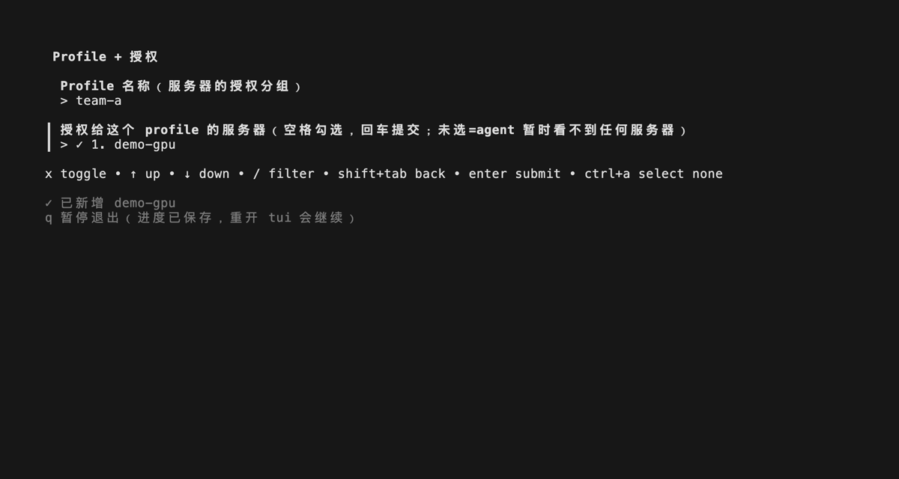

**截图里要注意什么**：

- profile（服务器授权分组）默认使用本机主机名。先用退格键或 `Ctrl+U` 清空，再输入 `team-a`。
- 回车进入服务器多选列表后，按空格或 `x` 勾选 `demo-gpu`；再按回车提交。两个键都有效；界面底部只提示 `x toggle`。未勾选任何服务器时，agent 看不到服务器。
- 截图中的选项行显示 `✓ 1. demo-gpu`，表示这台服务器已勾选。提交后看状态行是否显示授权了 1 台服务器，并在第 6 步的 Profiles 页确认 `team-a` 包含 `demo-gpu`。
- 状态行显示 `demo-gpu` 已新增，说明服务器条目已经保存；提交授权后，状态行会显示授权了 1 台服务器。

对应命令行：`sshmgr profiles add team-a && sshmgr profiles grant team-a demo-gpu`

## 第 5 步：创建 project 并取得一次性令牌

**要做什么**：把 project（agent 的访问身份）命名为 `my-agent`，提交后立即保存一次性显示的 project token（发给 agent 的一次性访问令牌），再按界面给出的 `.mcp.json` 配置片段接入 Claude Code。

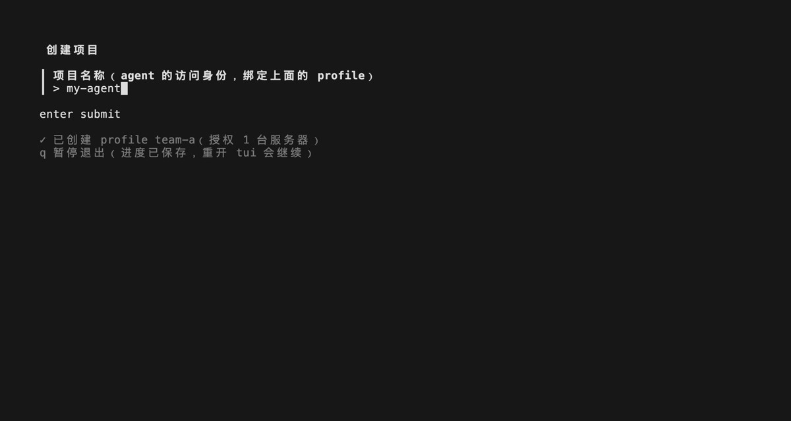

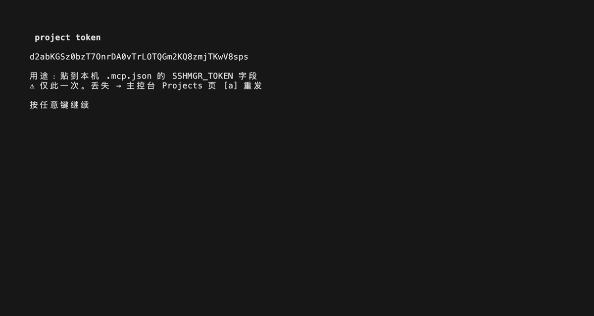

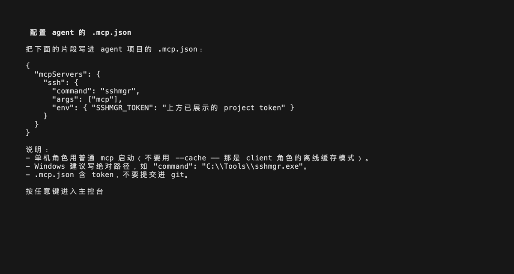

**截图里要注意什么**：

- project（agent 的访问身份）默认也使用本机主机名；清空后输入 `my-agent`。
- project token 只完整显示一次。截图里的令牌来自一次性演示环境，早已失效；你操作时必须在关闭该画面之前把真令牌抄下来。
- `.mcp.json` 配置片段里的 `"上方已展示的 project token"` 是占位说明；实际填写上一张图抄下的真令牌。
- `.mcp.json` 含有访问令牌，不要提交进 git。Windows 建议把 `"command": "sshmgr"` 改成 `sshmgr.exe` 的绝对路径。
- 按任意键退出配置画面后，终端图形界面进入日常管理页。

对应命令行：`sshmgr projects add my-agent --profile team-a`

## 第 6 步：检查服务器、授权分组和 project

**要做什么**：在管理页确认三件事：服务器 `demo-gpu` 存在，profile（服务器授权分组）`team-a` 包含它，project（agent 的访问身份）`my-agent` 绑定它。

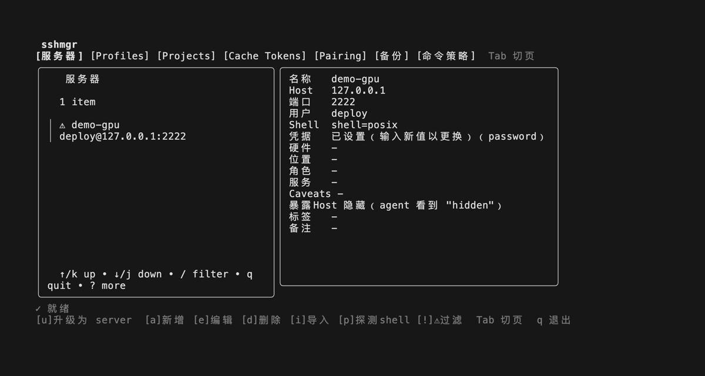

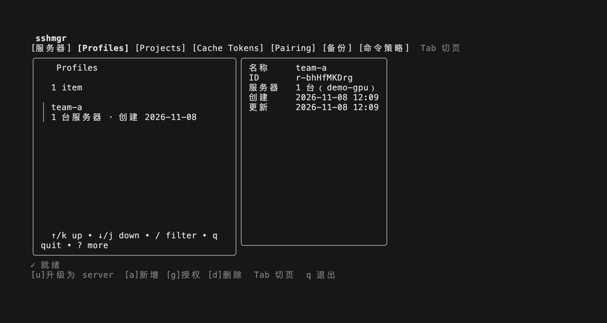

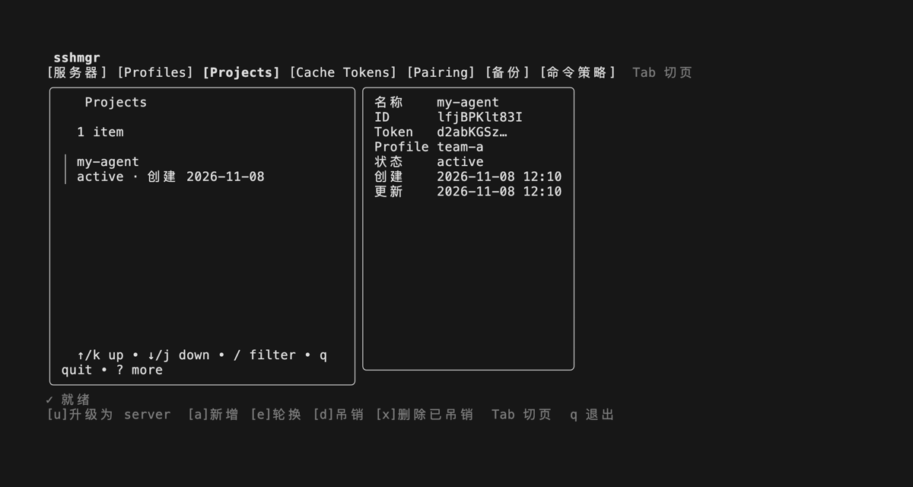

**截图里要注意什么**：

- `Tab` 切换页签，上下方向键或 `j`、`k` 移动列表。
- 服务器详情显示地址 `127.0.0.1:2222`、用户 `deploy`、凭据已设置。
- `⚠` 表示服务器条目需要注意：没有凭据、角色为空，或带有待补密钥口令标记。`demo-gpu` 已有密码凭据但角色为空，所以出现；本教程可以不处理，之后编辑服务器时补一个角色即可。
- 「暴露Host 隐藏」表示 `list_servers` 不把真实地址发给 agent，agent 会看到 `hidden`；sshmgr 自己仍使用 vault 里的真实地址连接。
- Profiles 页显示 `team-a` 有 1 台服务器 `demo-gpu`。
- Projects 页显示 `my-agent` 是 active 状态，并绑定 `team-a`。页签底部的按键提示会随当前页变化。

对应命令行：`sshmgr servers ls && sshmgr profiles ls && sshmgr projects show my-agent`

## 第 7 步：接入 Claude Code 并执行命令

**要做什么**：在运行 Claude Code 的项目目录创建 `.mcp.json`，把令牌写入 `SSHMGR_TOKEN`，然后启动 Claude Code，对它说：「只使用名为 ssh 的 MCP 服务器：列出可用服务器，然后在 demo-gpu 上运行 uname -a，简要说明结果。」

```json
{
  "mcpServers": {
    "ssh": {
      "command": "sshmgr",
      "args": ["mcp"],
      "env": {
        "SSHMGR_TOKEN": "<把一次性 project token 原样粘到这里>"
      }
    }
  }
}
```

启动 Claude Code 后，先确认它加载了 `ssh` 服务器，再输入上面那句中文请求。正常顺序是：

1. Claude Code 调用 `list_servers`，拿到 `demo-gpu` 的真实服务器编号；
2. Claude Code 调用 `exec_command`，在 `demo-gpu` 上执行 `uname -a`；
3. 返回 Linux 内核和处理器架构信息，退出码为 0。

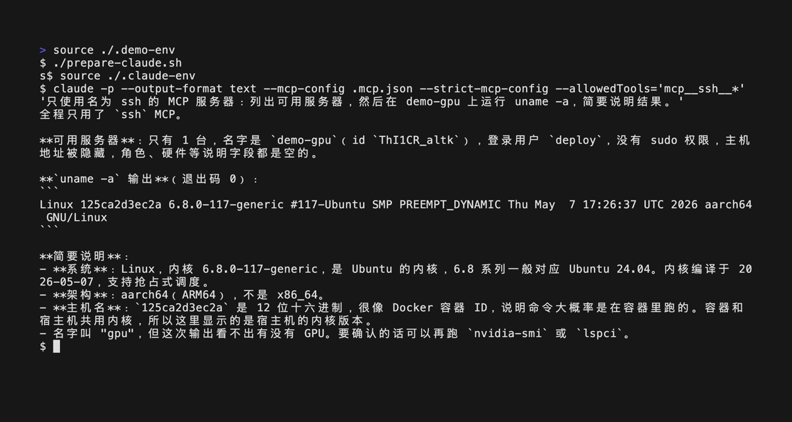

**截图里要注意什么**：截图为了自动录制，使用 `claude -p --output-format text --mcp-config .mcp.json --strict-mcp-config --allowedTools='mcp__ssh__*' '只使用名为 ssh 的 MCP 服务器：列出可用服务器，然后在 demo-gpu 上运行 uname -a，简要说明结果。'` 的非交互模式。画面上半部分能看到这条命令和请求，下半部分是 Claude 用普通文字给出的服务器列表、`uname -a` 输出和简要说明。你日常跟做时可以运行 `claude`，在输入框输入同一句请求。

对应命令行：无（这一步在 Claude Code 里完成）

## 常见差异

- **Windows**：二进制是 `sshmgr.exe`；`.mcp.json` 建议写绝对路径；master key 默认在 `C:\ProgramData\ssh-manager\master.key.plain`；mintty 下用 `winpty sshmgr.exe tui`。
- **服务器端口不是 22**：填写服务器表单时先清空端口输入行，再输入实际端口。
- **使用私钥**：密码留空，在私钥路径输入私钥文件路径；如果私钥本身有口令，再填写密钥口令。
- **令牌丢失**：project token 关闭画面后不能再看，用 `sshmgr projects rotate my-agent` 换发新令牌，并把新令牌更新到 `.mcp.json`。

## 接下来

- 完整流程、所有可选项与排错：[`getting-started.md`](./getting-started.md)
- 服务器增删改查：[`managing-servers.md`](./managing-servers.md)
- project token 生命周期与紧急处置：[`agent-access.md`](./agent-access.md)
- 应用场景示例：[`scenarios.md`](./scenarios.md)
- 给 AI agent 的工具规则模板：[`agent-tools.md`](./agent-tools.md)
- 多台机器共用一份 vault：[`quickstart-multi-machine.md`](./quickstart-multi-machine.md)
